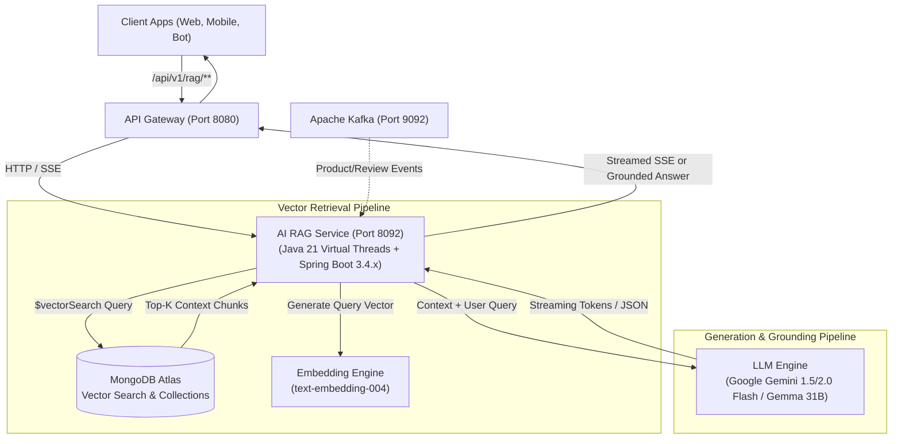

# Architectural Specification: Enterprise AI RAG Microservice (rag-service)

- **Document ID**: SPEC-2026-RAG-001
- **Status**: APPROVED
- **Date**: 2026-11-01
- **Target Stack**: Java 21 LTS (Virtual Threads), Spring Boot 3.4.x / 3.3.5, Spring AI, MongoDB Atlas Vector Search, Apache Kafka, Docker Compose

---

## 1. Context & Architectural Analysis

### 1.1 Examination of Existing Services

#### A. `recommendation-loyalty-service` (Port 8089)
- **Current Responsibilities**:
  - VIP Loyalty Wallet management (points accrual, cashback rates, tier calculations, refund reversals).
  - Co-purchase product recommendations using Redis Sorted Sets (`recommendations:co_bought:{sku}`) and deterministic curated fallbacks.
- **Evaluation for RAG Placement**:
  - *Anti-Pattern*: Merging RAG here violates the Single Responsibility Principle (SRP).
  - *Risk*: Transactional wallet operations require sub-20ms SLA and high consistency. Embedding LLM generation (which takes 400ms - 2500ms) and vector search operations into this service creates thread/memory contention and creates a single point of failure where AI slowdowns could block loyalty transactions or checkout.

#### B. `notification-service` (Port 8085)
- **Current Responsibilities**:
  - Asynchronous consumption of Kafka domain events (`order-events`, `payment-events`, `shipping-events`).
  - Dispatching SMS, Email, and live SSE event streams to active browser sessions.
- **Evaluation for RAG Placement**:
  - *Architectural Mismatch*: Notifications operate on a fire-and-forget, write-heavy asynchronous paradigm.
  - *Risk*: RAG is fundamentally an interactive, synchronous query-and-retrieve cycle (Conversational Search, Q&A Assistant, Semantic Catalog Browsing). Forcing RAG into the notification worker couples messaging pipelines with conversational AI sessions.

### 1.2 Decision: Independent `rag-service` (Port 8092)
An autonomous `rag-service` is mandated:
1. **Isolated Scaling**: Scale generative AI workloads independently from core transactional banking/order services.
2. **Virtual Threads Utilization**: Java 21 Virtual Threads (`Loom`) allow thousands of concurrent blocking HTTP calls to Vector Stores and LLM APIs without thread pool exhaustion.
3. **Multi-Domain Synthesis**: Can ingest catalog metadata from `inventory-service`, customer feedback from `review-rating-service`, and store policies without cross-service database coupling.
4. **Resilience Boundary**: If the LLM provider experiences latency spikes or outages, core e-commerce shopping and payment continue uninterrupted.

---

## 2. Architecture & High-Level Design



---

## 3. Retrieval Architecture (Vector Search Mechanism)

### 3.1 MongoDB Atlas Vector Search Definition
The retrieval mechanism leverages MongoDB Atlas `$vectorSearch` with Hierarchical Navigable Small World (HNSW) indexing.

#### Vector Index Definition (`vector_index`):
```json
{
  "fields": [
    {
      "type": "vector",
      "path": "embedding",
      "numDimensions": 768,
      "similarity": "cosine"
    },
    {
      "type": "filter",
      "path": "metadata.category"
    },
    {
      "type": "filter",
      "path": "metadata.inStock"
    },
    {
      "type": "filter",
      "path": "metadata.price"
    }
  ]
}
```

### 3.2 Aggregation Pipeline Query
```javascript
db.catalog_embeddings.aggregate([
  {
    $vectorSearch: {
      index: "vector_index",
      path: "embedding",
      queryVector: [/* 768-dim float array */],
      numCandidates: 100,
      limit: 5,
      filter: {
        "metadata.inStock": true
      }
    }
  },
  {
    $project: {
      _id: 1,
      skuCode: 1,
      title: 1,
      content: 1,
      metadata: 1,
      score: { $meta: "vectorSearchScore" }
    }
  }
])
```

---

## 4. Generation Pipeline & Prompt Engineering

### 4.1 System Prompt & Grounding Guardrails
```
You are the official AI Shopping Assistant for Enterprise E-Commerce Platform.
Answer customer inquiries accurately, politely, and concisely in the customer's language (Hebrew RTL by default).
Base your answers ONLY on the retrieved context below. If the information is not present in the context, state that you do not know and suggest contacting human customer support.
Never hallucinate specs, prices, or inventory levels that are not in the context.
Always cite the matching product SKU and price when recommending an item.

[RETRIEVED CONTEXT START]
{context_chunks}
[RETRIEVED CONTEXT END]
```

### 4.2 Streaming Protocol (SSE)
- Endpoint: `GET /api/v1/rag/chat/stream?query={query}&customerId={id}`
- MIME: `text/event-stream;charset=UTF-8`
- Emits chunks: `data: {"token": "...", "done": false}` followed by `data: {"done": true, "citations": [...]}`.

---

## 5. Domain Entities & Data Models

### 5.1 MongoDB Vector Document Entity
```java
@Document(collection = "catalog_embeddings")
@Data
@Builder
@NoArgsConstructor
@AllArgsConstructor
public class CatalogVectorDocument {
    @Id
    private String id;
    private String skuCode;
    private String title;
    private String textChunk;
    private List<Float> embedding;
    private Map<String, Object> metadata;
    private Instant indexedAt;
}
```

### 5.2 API Data Transfer Objects
```java
public record RagQueryRequest(
    @NotBlank String query,
    String customerId,
    String categoryFilter,
    Double maxPrice,
    Boolean inStockOnly,
    Integer topK
) {}

public record RagQueryResponse(
    String answer,
    List<CitationDto> citations,
    Double confidenceScore,
    String modelUsed,
    Long latencyMs
) {}

public record CitationDto(
    String skuCode,
    String title,
    Double price,
    Double score,
    String snippet
) {}
```

---

## 6. Resilience, Performance & Security

1. **Virtual Threads (Project Loom)**:
   - Configured with `spring.threads.virtual.enabled: true`.
   - Eliminates standard OS-thread pool bottlenecks during blocking I/O to MongoDB and LLM endpoints.
2. **Resilience4j Circuit Breaker**:
   - `slidingWindowSize: 20`, `failureRateThreshold: 50%`, `slowCallDurationThreshold: 3000ms`.
   - Automatic fallback response when downstream LLM quota or connection fails.
3. **Stateless JWT Security**:
   - Validates HMAC-SHA256 tokens passed via `Authorization: Bearer <token>` or `X-Customer-Id` forwarded by `api-gateway`.
