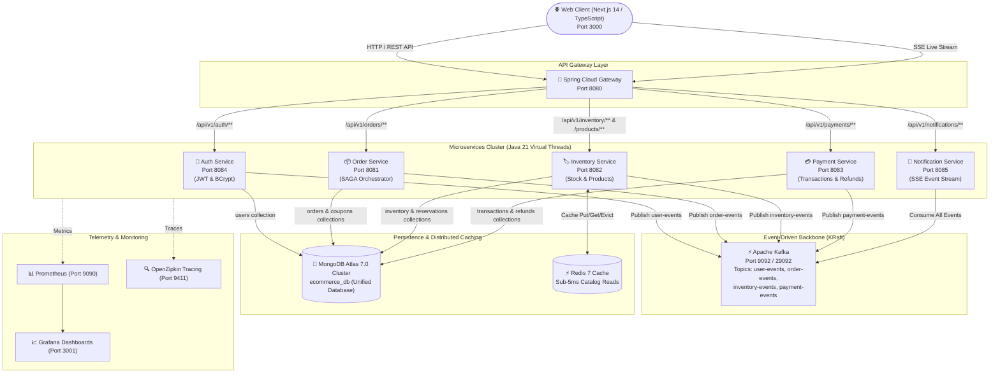

# 🛍️ Enterprise Distributed E-Commerce Microservices Platform

[](https://github.com/IDAN2468D/ecommerce-platform/actions/workflows/ci.yml)
[](https://www.oracle.com/java/)
[](https://spring.io/projects/spring-boot)
[](https://nextjs.org/)
[](https://kafka.apache.org/)
[](https://www.mongodb.com/atlas)
[](https://redis.io/)

פלטפורמת מסחר אלקטרוני מבוזרת ברמת Enterprise, מבוססת **Java 21 Virtual Threads**, **Spring Boot 3.3.5**, **Apache Kafka (KRaft)**, **MongoDB Atlas**, **Redis**, **Prometheus & Grafana**, וממשק **Next.js 14 App Router** מלא בעברית (RTL).

---

## 📐 ארכיטקטורת המערכת (System Architecture)



---

## 🌟 עיקרי היכולות והתכונות (Core Features)

### 1. שער כניסה ואבטחה מלאה (Standalone Auth Gate)
- **דפי כניסה מנותקים לחלוטין**: דפי `/login` ו-`/register` מבודדים ומעוצבים כמסכי שער עצמאיים, ללא חשיפת הקטלוג, עגלת הקניות או ה-Header של החנות לפני אימות.
- **הגנת מסכים (`AppShell & AuthGuard`)**: ניסיון גישה לדף הבית (`/`), לעגלה או להזמנות ללא טוקן תקף מפנה ישירות ובאופן אוטומטי לדף ההתחברות.
- **אסימוני `HMAC-SHA256 JWT` מבוזרים**: אסימונים חתומים במפתח סודי משותף (תוקף 24 שעות), המאומתים ישירות ב-`order-service` ברמת Zero-Trust ללא Session בשרת.
- **הצפנת סיסמאות `BCrypt`**: הצפנה עם Salt דינמי ב-`ecommerce_db.users` ב-MongoDB Atlas.

### 2. מסד נתונים מאוחד בענן (Unified MongoDB Atlas)
כל המיקרו-שירותים חולקים מסד נתונים אחד ומאוחד: **`ecommerce_db`** בקלאסטר `cluster0.purdk.mongodb.net`:
1. `users` – פרופילי משתמשים וסיסמאות מוצפנות (אינדקס ייחודי על `email`).
2. `inventory` – קטלוג מוצרים עשיר עם תמונות אמיתיות באיכות גבוהה ומחירים ב-`Decimal128`.
3. `inventory_reservations` – שריוני מלאי זמניים עבור טרנזקציות SAGA.
4. `orders` – הזמנות לקוחות עם תתי-מסמכים משובצים (`Embedded Order Items`).
5. `coupons` – מנוע קופונים והנחות דינמיות (`WELCOME10`).
6. `payment_transactions` – תנועות סליקה עם אינדקס אידמפוטנטיות ייחודי.
7. `payment_refunds` – זיכויים כספיים בעת ביטול הזמנה.

### 3. ארכיטקטורת SAGA מבוזרת מבוססת Apache Kafka
- **ביצוע הזמנה אטומי**:
  1. `Order Service` יוצר הזמנה בסטטוס `PENDING` ומשדר `OrderCreatedEvent`.
  2. `Inventory Service` משריין את הפריטים ומשדר `StockReservedEvent`.
  3. `Payment Service` מבצע סליקה ומאשר `PaymentCapturedEvent`.
  4. `Order Service` מאשר סופית את ההזמנה (`CONFIRMED`).
- **טרנזקציות פיצוי (Compensating Transactions)**:
  - ביטול הזמנה משדר `OrderCancelledEvent`, שגורם לשחרור אוטומטי של המלאי ב-`inventory-service` וביצוע זיכוי כספי מלא ב-`payment-service`.

### 4. שידור התראות חי (Server-Sent Events)
- ה-`Notification Service` מאזין לכל ה-Topics ב-Kafka (`user-events`, `order-events`, `inventory-events`, `payment-events`).
- פותח ערוץ SSE ישיר מול הדפדפן ומציג התראות Toast בזמן אמת וספירת הודעות בפעמון ההתראות.

### 5. זיכרון מטמון מבוזר (Redis Distributed Cache)
- קריאות קטלוג ומלאי נשמרות ב-Redis עם TTL של 15 דקות.
- מהירות תגובה תת-שנייתית: פחות מ-**5ms** לקריאת מוצר.
- מנגנון אינוולידציה אוטומטי (`@CacheEvict`) בעת שריון או עדכון מלאי.

### 6. מערך ניטור וטלמטריה (Full Observability Stack)
- **Prometheus** (פורט 9090) – מגרד מדדים חיים (Metrics) מכל 5 המיקרו-שירותים דרך Spring Boot Actuator.
- **Grafana** (פורט 3001) – דשבורד מובנה ומוכן מראש עם גרפים של Throughput, זמני תגובה, ניצולת Heap ו-Virtual Threads.
- **OpenZipkin** (פורט 9411) – מעקב מבוזר (Distributed Tracing) אחר כל בקשת HTTP ואירוע Kafka.

---

## 🗂️ מבנה הפרויקט (Repository Layout)

```
.
├── .github/
│   └── workflows/
│       └── ci.yml                     # תהליך CI/CD לבדיקה ובנייה אוטומטית ב-GitHub Actions
├── api-gateway/                       # Spring Cloud Gateway (Port 8080)
├── auth-service/                      # אימות והרשמה עם JWT ו-BCrypt (Port 8084)
├── common-events/                     # מודול אירועים משותף ל-Kafka SAGA
├── inventory-service/                 # שירות מלאי, מוצרים וקאש Redis (Port 8082)
├── notification-service/              # שירות התראות מבוסס SSE ו-Kafka (Port 8085)
├── order-service/                     # שירות הזמנות, מנוע קופונים ו-SAGA (Port 8081)
├── payment-service/                   # שירות תשלומים וזיכויים (Port 8083)
├── web-client/                        # ממשק משתמש Next.js 14 App Router (Port 3000)
├── grafana/                           # הגדרות פרוביז'נינג ודשבורדים מוכנים ל-Grafana
├── docker-compose.yml                 # פריסת כלל הקונטיינרים והתשתיות
├── prometheus.yml                     # הגדרות סקרפר של Prometheus לכל המיקרו-שירותים
├── test-e2e.ps1                       # סקריפט בדיקות אינטגרציה מלא מקצה לקצה (10 בדיקות)
├── pom.xml                            # Root Maven POM (Java 21 Multi-Module Project)
├── .env.example                       # דוגמת משתני סביבה לחיבור ל-MongoDB Atlas
└── README.md                          # תיעוד הפרויקט
```

---

## 🚀 הוראות הרצה מקומית (Quick Start)

### דרישות מקדימות:
- **Docker Desktop** (עם תמיכה ב-Compose v2)
- **JDK 21** (לבנייה ופיתוח מקומי)
- **Node.js 20+** (לבניית ממשק ה-Next.js)

### שלב 1: שכפול הפרויקט
```bash
git clone https://github.com/IDAN2468D/ecommerce-platform.git
cd ecommerce-platform
```

### שלב 2: הגדרת משתני סביבה
העתק את קובץ הדוגמה והזן את פרטי החיבור ל-MongoDB Atlas שלך:
```bash
cp .env.example .env
```

### שלב 3: בנייה והרצת כל המערך ב-Docker
```bash
# בניית כל חבילות ה-JAR
./mvnw clean package -DskipTests

# הרמת כל 12 הקונטיינרים ברקע
docker compose up --build -d
```

### שלב 4: הרצת ממשק ה-Web Client
```bash
cd web-client
npm install
npm run build
npm run start
```

---

## 🌐 כתובות ופורטים של השירותים

| שירות / רכיב | כתובת מקומית | תיאור |
| :--- | :--- | :--- |
| **Storefront Web Client** | `http://localhost:3000` | ממשק המשתמש ב-Next.js (מופנה אוטומטית ל-`/login`) |
| **API Gateway** | `http://localhost:8080` | שער הכניסה הראשי לכל ה-REST APIs |
| **Auth Service** | `http://localhost:8084` | שירות אימות והרשמה עם JWT |
| **Order Service** | `http://localhost:8081` | שירות ניהול הזמנות ו-SAGA |
| **Inventory Service** | `http://localhost:8082` | שירות קטלוג ומלאי עם Redis |
| **Payment Service** | `http://localhost:8083` | שירות תשלומים וזיכויים |
| **Notification Service** | `http://localhost:8085` | שירות ערוץ שידור חי SSE |
| **Kafka UI** | `http://localhost:8090` | ממשק ניהול Topics ואירועים ב-Kafka |
| **Prometheus** | `http://localhost:9090` | שרת איסוף מטריקות וטלמטריה |
| **Grafana** | `http://localhost:3001` | דשבורדים חיים (משתמש: `admin`, סיסמה: `admin`) |
| **OpenZipkin** | `http://localhost:9411` | מעקב מבוזר אחר Trace ID ו-Span ID |

---

## 🧪 בדיקות אינטגרציה מקצה לקצה (End-to-End Tests)

בפרויקט קיים סקריפט בדיקה אוטומטי מלא ב-PowerShell המוודא את כל 10 השלבים במערכת:
```powershell
.\test-e2e.ps1
```

### פירוט 10 הבדיקות:
1. **Inventory & Redis Cache**: קריאה ראשונה והכנסה לקאש, קריאה שנייה תת-5ms מ-Redis.
2. **Coupon Engine**: אימות קופון `WELCOME10` והחלת הנחה של 10%.
3. **Kafka SAGA Order**: יצירת הזמנה מתואמת מול Gateway, שריון מלאי, ואישור סליקה.
4. **Order Querying**: שליפת ההזמנה המאושרת לפי מזהה.
5. **SAGA Compensation**: ביטול הזמנה והפעלת טרנזקציות פיצוי (שחרור מלאי וזיכוי כספי).
6. **Live SSE Stream**: אימות חיבור חי לערוץ השידור מול `notification-service`.
7. **Observability**: אימות תקינות של כל המיקרו-שירותים ב-Prometheus ו-Grafana.
8. **Next.js Storefront**: אימות שרת ה-Web והחזרת קוד HTTP 200.
9. **Products Catalog API**: אימות שליפת מוצרים ותמונות אמיתיות מה-API.
10. **Authentication & User Service**: רישום משתמש חדש ב-MongoDB Atlas, הנפקת JWT, התחברות, שליפת פרופיל `GET /me`, וביצוע הזמנה חתומה באמצעות ה-JWT!

---

## ⚙️ CI/CD Pipeline (GitHub Actions)

קובץ ה-Workflow נמצא ב-[.github/workflows/ci.yml](.github/workflows/ci.yml) ומבצע בכל `Push` ו-`Pull Request`:
- **Job 1 (Backend)**: הגדרת JDK 21 Temurin, הרצת כל מבחני היחידה (`./mvnw clean test`), ובניית כל ה-JARs.
- **Job 2 (Frontend)**: התקנת תלויות ב-Node.js 20 ובניית Bundle מלא של Next.js (`npm run build`).
- **Job 3 (Docker Compose)**: אימות תחבירי מלא של כל קובץ ה-Docker Compose.

---

## 📄 רישיון (License)
פרויקט זה מוגן תחת רישיון MIT.
פותח ונבנה על ידי **עידן קזם (Idan Kazam)**.
