# 🛍️ Enterprise Distributed E-Commerce Microservices & Multi-Agent AI Platform

[](https://github.com/IDAN2468D/ecommerce-platform/actions/workflows/ci.yml)
[](https://www.oracle.com/java/)
[](https://spring.io/projects/spring-boot)
[](https://fastapi.tiangolo.com/)
[](https://nextjs.org/)
[](https://kafka.apache.org/)
[](https://www.mongodb.com/atlas)
[](https://redis.io/)
[](https://ai.google.dev/)
[](https://www.docker.com/)

פלטפורמת מסחר אלקטרוני מבוזרת מתקדמת ברמת **Enterprise (v5.0)**, המשלבת **18 מיקרו-שירותים**, נחיל סוכני בינה מלאכותית אוטונומיים (**Multi-Agent AI Swarm**), מנוע **Agentic RAG** מבוסס **MongoDB Atlas Vector Search** ו-**Google Gemini**, ארכיטקטורת **SAGA 5-Step Orchestration** מונחית אירועים ב-**Apache Kafka (KRaft)**, מנגנון **Transactional Outbox Pattern** עם ממסר אוטומטי (Daemon), ואינטגרציית **Model Context Protocol (MCP)** ל-**Google Workspace**. ממשק משתמש מלא, מודרני ומהיר ב-**Next.js 14 App Router** בעברית מלאה (RTL).

---

## 📐 ארכיטקטורת המערכת (System Architecture)

```mermaid
flowchart TD
    Client(["🌐 Storefront Web Client (Next.js 14 / TypeScript / RTL)<br>Port 3000 / Cloudflare Tunnel"])

    subgraph Edge ["API Gateway & Security Layer (Port 8080)"]
        Gateway["🚪 Spring Cloud Gateway<br>JWT Filter • Redis Rate-Limiter • Trace Context Propagator"]
    end

    subgraph CoreServices ["Core E-Commerce SAGA Microservices (Java 21 Virtual Threads)"]
        AuthSvc["🔐 Auth Service<br>Port 8084 (JWT & BCrypt)"]
        OrderSvc["📦 Order Service<br>Port 8081 (SAGA Orchestrator & Outbox)"]
        InvSvc["🏷️ Inventory Service<br>Port 8082 (Pessimistic Locking)"]
        PaySvc["💳 Payment Service<br>Port 8083 (Idempotent Ledger)"]
        ShipSvc["🚚 Shipping Service<br>Port 8086 (SAGA Step 5 Tracking)"]
        CartSvc["🛒 Cart & Wishlist<br>Port 8088 (Redis Hash <2ms)"]
        NotifSvc["🔔 Notification Service<br>Port 8085 (Live SSE Stream)"]
    end

    subgraph AISwarm ["AI & Agentic Intelligence Layer"]
        SwarmSvc["🤖 Agent Swarm Service<br>Port 8093 (Python / FastAPI)<br>10 Autonomous Specialized Agents"]
        RagSvc["🧠 RAG & Vector Search<br>Port 8092 (Gemini + Atlas Search)"]
        PricingSvc["📈 Dynamic Pricing & Auto-Buy<br>Port 8095 (30-Day Ledger & Synergy)"]
        FraudSvc["🛡️ Fraud & Risk Guard<br>Port 8096 (Pre-Capture Velocity)"]
        RmaSvc["📦 RMA & Returns Service<br>Port 8094 (Gemini Vision Inspection)"]
    end

    subgraph BusinessTier ["Business & Marketplace Ecosystem"]
        LoyaltySvc["⭐ Loyalty & Recommendations<br>Port 8089 (VIP Cashback 5%)"]
        ReviewSvc["⭐ Review & Rating<br>Port 8087 (AI Pros & Cons)"]
        MarketSvc["🏬 Multi-Vendor Marketplace<br>Port 8099 (Merchant Split Payouts)"]
        AnalyticsSvc["📊 Merchant Analytics & AI Copilot<br>Port 8097 (CQRS Stock-Out Forecast)"]
        SubSvc["🔄 Subscription Billing<br>Port 8098 (Recurring SAGA Engine)"]
        WorkspaceSvc["📁 Workspace Integration Service<br>Port 8091 (Drive & Calendar MCP)"]
        McpSidecar["🔌 Google Workspace MCP Sidecar<br>Port 8000 (Streamable HTTP)"]
    end

    subgraph Messaging ["Event-Driven Backbone & Resilience"]
        Kafka["⚡ Apache Kafka (KRaft Mode)<br>Port 9092 / 29092"]
        OutboxDaemon["🔁 Transactional Outbox Daemon<br>Zero Message Loss Buffer Replay"]
    end

    subgraph DataTier ["Persistence, Vector & Caching"]
        Atlas[("🍃 MongoDB Atlas 7.0 Cluster<br>ecommerce_db (Unified Document & Vector Store)")]
        Redis[("⚡ Redis 7 Alpine Cluster<br>Sub-5ms Catalog & Sub-2ms Cart Cache")]
    end

    subgraph Observability ["Telemetry & Distributed Tracing"]
        Prometheus["📊 Prometheus (Port 9090)"]
        Grafana["📈 Grafana Dashboards (Port 3001)"]
        Zipkin["🔍 OpenZipkin Traces (Port 9411)"]
        KafkaUI["🎛️ Kafka UI (Port 8090)"]
    end

    Client -->|REST & SSE Requests| Gateway
    Gateway --> CoreServices
    Gateway --> AISwarm
    Gateway --> BusinessTier

    OrderSvc -->|Buffered Orders| Atlas
    OutboxDaemon -->|Tail Outbox Collection| Atlas
    OutboxDaemon -->|Replay Pending Events| Kafka

    CoreServices <-->|Pub/Sub Events| Kafka
    AISwarm <-->|Stream Actions & Events| Kafka
    BusinessTier <-->|Domain Events| Kafka
    WorkspaceSvc <-->|FastMCP Protocol| McpSidecar

    CoreServices <-->|Read / Write| Atlas
    AISwarm <-->|Vector KNN Search & Documents| Atlas
    BusinessTier <-->|Read / Write| Atlas

    InvSvc <-->|Cache Hit/Miss| Redis
    CartSvc <-->|Real-time Sessions| Redis
    RagSvc <-->|Semantic Query Cache| Redis

    Gateway & CoreServices & AISwarm & BusinessTier -.->|OpenTelemetry / Micrometer| Prometheus
    Prometheus --> Grafana
    Gateway & CoreServices & AISwarm -.->|B3 Traces| Zipkin
```



---

## 🌟 עיקרי היכולות והתכונות (Core Architecture & Features)

### 1. שער כניסה אחוד ואבטחת Zero-Trust (`api-gateway` & `auth-service`)
- **Single Entry Point**: שער גישה אחוד ב-Spring Cloud Gateway (פורט 8080) המנתב ל-18 מיקרו-שירותים.
- **אבטחת JWT ו-BCrypt**: אסימוני `HMAC-SHA256 JWT` חתומים (תוקף 24 שעות) המאומתים בכל שירות קצה ללא Session בשרת.
- **הגבלת קצב דינמית (Rate Limiting)**: הגנה מפני התקפות DDoS באמצעות Redis Token-Bucket (40 RPM ל-RAG, 60 RPM להזמנות, 180 RPM לרוחב המערכת).
- **בידוד מסכים מלא בממשק**: דפי `/login` ו-`/register` עצמאיים, מנגנון `AuthGuard` חוסם גישה לקטלוג, לסל ולהזמנות ללא אימות מוקדם.

### 2. ארכיטקטורת SAGA מבוזרת מרובת-שלבים (5-Step Distributed SAGA)
ביצוע הזמנות אטומי, מהימן ועמיד לכשלים באמצעות Kafka Topics (`order-events`, `inventory-events`, `payment-events`, `shipping-events`, `notification-events`):
1. **Order Initiation**: ה-`Order Service` קולט הזמנה, מחיל קופון דינמי, רושם מסמך בסטטוס `PENDING` ומפיק אירוע `OrderCreatedEvent`.
2. **Stock Reservation**: ה-`Inventory Service` משריין מלאי בנעילה פסימית למניעת Race Conditions ומשדר `StockReservedEvent`.
3. **Payment Capture**: ה-`Payment Service` מבצע סליקה אידמפוטנטית (Idempotency Key) ומפיק אירוע `PaymentCapturedEvent`.
4. **Logistics & Delivery**: ה-`Shipping Service` מקצה חברת שילוח, מייצר מספר מעקב ומפיק `ShipmentScheduledEvent`.
5. **Confirmation & Invoicing**: ה-`Order Service` מעביר את ההזמנה לסטטוס `CONFIRMED`, מפיק חשבונית מס וקבלה רשמית בפורמט PDF, ושירות ההתראות מקפיץ הודעה חיה ב-SSE לדפדפן.
- **טרנזקציות פיצוי (Compensating Transactions)**: במקרה של כשל באחד השלבים או ביטול ידני (`POST /orders/{id}/cancel`), משודר `OrderCancelledEvent` המפעיל שרשרת פיצוי מיידית: שחרור המלאי המשוריין, ביצוע זיכוי כספי מלא (Refund) וביטול תעודת המשלוח.

### 3. עמידות לכשלים עם Transactional Outbox Pattern & Daemon Relay
- **Offline Order Buffering**: גם בעת נפילת Kafka או ניתוק רשת מקומי, שירות ההזמנות כותב באופן אטומי לקולקציית `outbox_orders` ב-MongoDB Atlas עם סטטוס `PENDING`.
- **Automatic Relay Daemon**: דמון ייעודי (`outbox-relay`) בסביבת Python/Alpine מנטר את מסד הנתונים, מזהה הזמנות ממתינות, ומשדר אותן מיידית ל-Kafka כאשר הברוקר חוזר לפעילות תקינה ללא אובדן שום הזמנה.

### 4. נחיל סוכני בינה מלאכותית אוטונומיים (Multi-Agent Swarm Service)
מודול בינה מלאכותית מבוסס Python/FastAPI (פורט 8093) המפעיל 10 סוכנים מתמחים הפועלים בתיאום תחת `SupervisorRouterAgent`:
1. **CatalogDiscoveryAgent**: איתור מוצרים סמנטי והתאמת קטלוג חכמה לפי צרכי המשתמש.
2. **CartPricingLoyaltyAgent**: ניהול סלי קניות, בדיקת זכאות לקופונים והחלת הטבות מועדון VIP.
3. **OrderLogisticsWorkspaceAgent**: מעקב שילוחים, עדכון סטטוסים ותיאום פגישות אספקה.
4. **KafkaAutonomousOpsAgent**: ניטור אירועים ונושאי Kafka, אבחון צווארי בקבוק ושחזור הודעות.
5. **ReturnsDisputeAgent**: ניהול בקשות החזרה (RMA) ויישוב מחלוקות צרכניות.
6. **PriceWatchAutoBuyAgent**: מעקב ירידות מחיר והפעלת רכישה אוטומטית (Auto-Buy Trigger).
7. **VisualBundleStylistAgent**: יצירת חבילות מוצרים משלימות (Bundle Synergy) בהנחה מיוחדת.
8. **FraudRiskGuardAgent**: הערכת סיכוני הונאה טרם סליקה ובדיקת מהירות עסקאות (Velocity).
9. **DynamicBargainingAgent**: סוכן משא ומתן אינטראקטיבי המציע הנחות מותאמות אישית בזמן אמת.
10. **SupervisorRouterAgent**: מנתב-על המפענח כוונות משתמש (Intent Classification) ומפעיל את הסוכנים הרלוונטיים במקביל.

### 5. מנוע Agentic RAG וחיפוש מולטי-מודאלי (`rag-service`)
- **MongoDB Atlas Vector Search**: אינדוקס וקטורי מלא של כל קטלוג המוצרים עם Embeddings של Google Gemini.
- **Semantic Caching**: שמירת תשובות סמנטיות ב-Redis עם דמיון קוסינוס (Cosine Similarity) למענה מיידי בפחות מ-10ms.
- **Agentic Actions**: הסוכן יכול לבצע פעולות ישירות במערכת תוך כדי שיחה (כגון הוספת מוצר לסל, בדיקת מלאי, או הפעלת השוואת מוצרים).
- **Multimodal Visual & Voice Search**: חיפוש מוצרים באמצעות העלאת תמונה (Gemini Vision) או פקודה קולית לזיהוי מאפיינים ויזואליים והתאמה מדויקת לקטלוג.
- **Smart Product Comparison**: מנגנון השוואת מוצרים חכם המנתח מפרטים טכניים ומפיק פסק דין (AI Verdict) מנומק בהתאם לשימושי הלקוח.

### 6. מערך לוגיסטיקה הפוכה, תמחור והגנת הונאה מתקדמים
- **RMA & Reverse Logistics (`rma-returns-service`)**: שירות החזרות אוטונומי המשתמש ב-Gemini Vision לבדיקת צילומי פגמים במוצרים, אישור RMA מיידי וזיכוי אוטומטי של ארנק הלקוח (Store Credit).
- **Dynamic Pricing Engine (`dynamic-pricing-service`)**: מנוע תמחור דינמי המנהל ספר היסטוריית מחירים ל-30 יום, מחשב הנחות סינרגיה לחבילות מוצרים, ומאפשר ללקוחות להגדיר מחיר יעד לרכישה אוטומטית.
- **Fraud Risk Guard (`fraud-risk-service`)**: בדיקות סיכון טרום-סליקה בחלונות זמן נעים (Sliding-Window Velocity), זיהוי דפוסי רכישה חריגים וחסימת ניסיונות הונאה בזמן אמת.
- **Merchant Analytics & Forecasting (`merchant-analytics-service`)**: ארכיטקטורת CQRS המנתחת טלמטריה ומסחר, חוזה חוסרים במלאי (Stock-Out Forecasting) ומציעה Copilot מסחרי למנהלי חנות.
- **Subscription Billing (`subscription-billing-service`)**: מנוע חידוש מינויים תקופתיים (SAGA Recurring Billing) עם גבייה אוטומטית והודעות חידוש.
- **Multi-Vendor Marketplace (`marketplace-vendor-service`)**: תמיכה בריבוי מוכרים, ניהול פרופילי חנויות, ופיצול תשלומים ועמלות סליקה (Split Payouts).

### 7. אינטגרציית Google Workspace באמצעות Model Context Protocol (MCP)
- **ארכוב חשבוניות מס ב-Google Drive**: בעת הפקת חשבונית רשמית, השירות מעלה ומארכב את מסמך ה-PDF ישירות לתיקיית הענן דרך פרוטוקול MCP (`create_drive_file`).
- **תיאום מועדי משלוח ב-Google Calendar**: בעת תזמון אספקה, אירוע מסודר נוצר אוטומטית ביומן הלקוח (`create_event`) כולל מועד ההגעה ומספר המעקב. ביטול משלוח מוחק את האירוע ומעדכן את הלקוח.

### 8. ניטור וטלמטריה מלאה (Full Observability Stack)
- **Prometheus** (פורט 9090): איסוף מדדים בזמן אמת מכל 18 המיקרו-שירותים דרך Spring Boot Actuator ו-FastAPI Metrics.
- **Grafana** (פורט 3001): דשבורדים ויזואליים מוכנים עם גרפים של Throughput, Latency, שגיאות HTTP, ניצולת זיכרון JVM ו-Virtual Threads.
- **OpenZipkin** (פורט 9411): מעקב מבוזר (Distributed Tracing) אחר כל קריאת רשת מקצה לקצה עם Trace ID ו-Span ID מוטמעים בכל לוג.
- **Kafka UI** (פורט 8090): ניהול ויזואלי של כל ה-Topics, הודעות ה-JSON, צרכנים (Consumer Groups) ומחיצות (Partitions).

---

## 🗂️ מבנה הפרויקט (Repository Layout)

```
.
├── .github/workflows/ci.yml           # תהליך CI/CD אוטומטי לבדיקות ובנייה ב-GitHub Actions
├── agent-swarm-service/               # נחיל סוכני AI מתמחים ב-Python / FastAPI (Port 8093)
├── api-gateway/                       # Spring Cloud Gateway עם JWT ו-Rate Limiting (Port 8080)
├── auth-service/                      # אימות והרשמה עם JWT ו-BCrypt (Port 8084)
├── cart-wishlist-service/             # סל קניות ו-Wishlist מהירים ב-Redis ו-MongoDB (Port 8088)
├── common-events/                     # מודול אירועים ו-DTOs משותף ל-Kafka SAGA
├── credentials/                       # תצורות גישה מאובטחות (מוחרגות מ-Git)
├── dynamic-pricing-service/           # תמחור דינמי, ספר מחירים 30 יום ו-Auto-Buy (Port 8095)
├── fraud-risk-service/                # הגנת הונאות בזמן אמת ו-Velocity Checks (Port 8096)
├── google-workspace-mcp/              # קונטיינר Sidecar לשרת MCP (Streamable HTTP) (Port 8000)
├── grafana/                           # הגדרות פרוביז'נינג ודשבורדים מוכנים ל-Grafana
├── inventory-service/                 # שירות מלאי, נעילות פסימיות וקאש Redis (Port 8082)
├── marketplace-vendor-service/        # זירת מסחר מרובת סוחרים ופיצול תשלומים (Port 8099)
├── merchant-analytics-service/        # ניתוח נתונים, חיזוי מלאי ו-AI Copilot (Port 8097)
├── notification-service/              # שירות שידור התראות חי (SSE) ו-Kafka (Port 8085)
├── order-service/                     # ניהול הזמנות, מנוע קופונים, SAGA ו-Outbox (Port 8081)
├── payment-service/                   # שירות סליקה אידמפוטנטית וזיכויים כספיים (Port 8083)
├── rag-service/                       # מנוע RAG וקטורי, חיפוש ויזואלי וסמנטי עם Gemini (Port 8092)
├── recommendation-loyalty-service/    # מנוע המלצות חכם ומועדון לקוחות VIP (Port 8089)
├── review-rating-service/             # ביקורות מאומתות וסיכומי ביקורת AI (Port 8087)
├── rma-returns-service/               # לוגיסטיקה הפוכה, זיהוי פגמים ב-Gemini Vision (Port 8094)
├── scripts/                           # סקריפטי עזר: outbox_relay_daemon, import_products וניתוח קטלוג
├── shipping-delivery-service/         # שירות שילוח ואספקה (שלב 5 ב-SAGA) (Port 8086)
├── subscription-billing-service/      # ניהול מנויים וחיובים תקופתיים (Port 8098)
├── web-client/                        # ממשק משתמש Next.js 14 App Router, עברית מלאה ו-Tailwind (Port 3000)
├── workspace-integration-service/     # אינטגרציית Model Context Protocol ל-Google Workspace (Port 8091)
├── docker-compose.yml                 # תזמור כלל השירותים והתשתיות בקונטיינרים
├── prometheus.yml                     # הגדרות סקרפר של Prometheus לכל המיקרו-שירותים
├── render.yaml                        # תצורת פריסה לענן הייצור ב-Render
├── test-e2e.ps1                       # סקריפט בדיקות אינטגרציה מקצה לקצה (18 שלבים)
├── pom.xml                            # Root Maven POM (Java 21 Multi-Module Project)
├── .env.example                       # קובץ דוגמה למשתני סביבה וחיבור ל-MongoDB Atlas
└── README.md                          # תיעוד הפרויקט
```

---

## 🌐 כתובות ופורטים של השירותים (Service Matrix)

| שירות / רכיב | פורט | נתיב ב-Gateway | טכנולוגיה | תיאור |
| :--- | :---: | :--- | :--- | :--- |
| **Storefront Web Client** | `3000` | ישיר | Next.js 14, Tailwind, RTL | חנות אינטרנטית מלאה, צ'אט AI וניהול הזמנות |
| **API Gateway** | `8080` | `/` | Spring Cloud Gateway | שער כניסה אחוד, ניתוב, JWT ו-Rate Limiting |
| **Order Service** | `8081` | `/api/v1/orders/**` | Spring Boot 3, Java 21 | ניהול הזמנות, SAGA Orchestration, Outbox וקופונים |
| **Inventory Service** | `8082` | `/api/v1/inventory/**`, `/products/**` | Spring Boot 3, Redis | קטלוג מוצרים, נעילות פסימיות ואינוולידציית קאש |
| **Payment Service** | `8083` | `/api/v1/payments/**` | Spring Boot 3, MongoDB | סליקה פיננסית אידמפוטנטית וזיכויים |
| **Auth Service** | `8084` | `/api/v1/auth/**` | Spring Boot 3, JWT, BCrypt | אימות, הרשמה וניהול פרופילי משתמשים |
| **Notification Service** | `8085` | `/api/v1/notifications/**` | Spring Boot 3, SSE | שידור התראות Push בזמן אמת בדפדפן |
| **Shipping Service** | `8086` | `/api/v1/shipping/**` | Spring Boot 3, Kafka | תזמון משלוחים, מספרי מעקב ואינטגרציית מובילים |
| **Review & Rating** | `8087` | `/api/v1/reviews/**` | Spring Boot 3, Gemini | ביקורות לקוחות מאומתות וסיכומי יתרונות/חסרונות AI |
| **Cart & Wishlist** | `8088` | `/api/v1/cart/**`, `/wishlist/**` | Spring Boot 3, Redis Hash | סל קניות מבוסס זיכרון מהיר (<2ms) וסנכרון לענן |
| **Loyalty & Recs** | `8089` | `/api/v1/loyalty/**`, `/recommendations/**` | Spring Boot 3, MongoDB | מועדון לקוחות VIP, צבירת נקודות והמלצות קנייה |
| **Workspace Integration** | `8091` | `/api/v1/workspace/**` | Spring Boot 3, MCP SDK | ארכוב חשבוניות ב-Drive ויומן פגישות ב-Calendar |
| **RAG & Vector Search** | `8092` | `/api/v1/rag/**` | Spring Boot 3, Atlas Vector, Gemini | מנוע חיפוש סמנטי, פעולות סוכן וחיפוש ויזואלי |
| **Agent Swarm Service** | `8093` | `/api/v1/agents/**` | Python 3.11, FastAPI | נחיל של 10 סוכני בינה מלאכותית אוטונומיים |
| **RMA & Returns** | `8094` | `/api/v1/returns/**` | Spring Boot 3, Gemini Vision | לוגיסטיקה הפוכה, ניתוח נזקים וזיכוי ארנק מיידי |
| **Dynamic Pricing** | `8095` | `/api/v1/pricing/**` | Spring Boot 3, MongoDB | היסטוריית מחירי 30 יום, חבילות סינרגיה ו-Auto-Buy |
| **Fraud & Risk Guard** | `8096` | `/api/v1/fraud/**` | Spring Boot 3, Redis | זיהוי הונאות בזמן אמת, חלונות מהירות וספי סיכון |
| **Merchant Analytics** | `8097` | `/api/v1/analytics/**` | Spring Boot 3, CQRS | דוחות סוחרים, חיזוי אזילת מלאי ו-AI Copilot |
| **Subscription Billing** | `8098` | `/api/v1/subscriptions/**` | Spring Boot 3, Scheduler | חידוש מינויים תקופתיים ומחזורי חיוב אוטומטיים |
| **Marketplace Service** | `8099` | `/api/v1/marketplace/**` | Spring Boot 3, MongoDB | ניהול סוחרים, פרופילי חנות ופיצול תשלומים |
| **Google Workspace MCP** | `8000` | ישיר | FastMCP, Python | שרת צד (Sidecar) לחשיפת כלי ענן Google |
| **Transactional Outbox** | - | רקע (Docker) | Python 3.11 Daemon | ממסר הודעות מ-MongoDB ל-Kafka בעת חזרת קו |
| **Apache Kafka (KRaft)** | `9092` / `29092` | פנימי / חיצוני | Confluent Kafka 7.6 | ערוץ אירועים אסינכרוני מבוזר ללא Zookeeper |
| **Kafka UI** | `8090` | ישיר | Provectus Kafka UI | ממשק גרפי לניהול נושאים והודעות Kafka |
| **Redis Cache** | `6379` | פנימי | Redis 7.0 Alpine | מטמון מבוזר מהיר לקטלוג, סל ומגבלות קצב |
| **MongoDB Atlas** | `27017` / ענן | פנימי / Atlas | MongoDB 7.0 Wire | מסד נתונים מאוחד למסמכים ואינדקסים וקטוריים |
| **Prometheus** | `9090` | ישיר | Prometheus Server | איסוף מטריקות וטלמטריה מכל השירותים |
| **Grafana** | `3001` | ישיר | Grafana Dashboards | דשבורדים חיים לביצועים ועומסים |
| **OpenZipkin** | `9411` | ישיר | Zipkin Tracing | מעקב אחר מסלולי בקשות מבוזרות |

---

## 🚀 הוראות הרצה מהירה (Quick Start)

### דרישות מקדימות:
- **Docker Desktop** (עם תמיכה ב-Compose v2 ו-WSL2 / Hyper-V)
- **JDK 21** (לבנייה ופיתוח מקומי)
- **Node.js 20+** (לבניית ממשק ה-Web)
- **Python 3.11+** (לפיתוח והרצת נחיל הסוכנים)

### שלב 1: שכפול הפרויקט
```bash
git clone https://github.com/IDAN2468D/ecommerce-platform.git
cd ecommerce-platform
```

### שלב 2: הגדרת משתני סביבה
העתק את קובץ הדוגמה והגדר את מחרוזת ה-MongoDB Atlas ומפתח ה-Gemini API:
```bash
cp .env.example .env
```

### שלב 3: בניית כל רכיבי ה-Java
```bash
# ב-Linux/macOS:
./mvnw clean package -DskipTests

# ב-Windows PowerShell:
.\mvnw.cmd clean package -DskipTests
```

### שלב 4: הרמת כלל הקונטיינרים והתשתיות ב-Docker
```bash
docker compose up --build -d
```
הפקודה תרים את כל 26 הקונטיינרים (מיקרו-שירותים, Kafka KRaft, Redis, Outbox Relay, Prometheus, Grafana, Zipkin ו-Web Client).

### שלב 5: הרצת ממשק המשתמש (לפיתוח מקומי עצמאי)
```bash
cd web-client
npm install
npm run dev
```
גש לדפדפן בכתובת: **`http://localhost:3000`**

---

## 🧪 בדיקות אינטגרציה מקצה לקצה (End-to-End Automated Suite)

בפרויקט קיים סקריפט אוטומטי מקיף ב-PowerShell המוודא 18 שלבים קריטיים במערכת:
```powershell
.\test-e2e.ps1
```

### פירוט 18 בדיקות האינטגרציה:
1. **Inventory & Redis Cache**: אימות קריאת קטלוג ראשונה והכנסה לקאש, קריאה שנייה תת-5ms מ-Redis.
2. **Dynamic Coupon Engine**: אימות קופון `WELCOME10` וחישוב הנחה של 10%.
3. **Kafka SAGA Order**: יצירת הזמנה מתואמת, שריון מלאי פסימי, ואישור סליקה אידמפוטנטי.
4. **Order Querying**: שליפת ההזמנה המאושרת לפי מזהה והשוואת נתונים.
5. **Official Hebrew Tax Invoice PDF**: הפקת מסמך חשבונית מס וקבלה רשמי בעברית בפורמט PDF (OpenPDF).
6. **Shipping & Delivery (Stage 5)**: תזמון אספקה ויצירת מספר מעקב למשלוח.
7. **SAGA Compensation**: ביטול הזמנה והפעלת טרנזקציות פיצוי (שחרור מלאי, זיכוי כספי וביטול שילוח).
8. **Live SSE Stream**: אימות חיבור חי לערוץ השידור מול `notification-service`.
9. **Observability Stack**: אימות תקינות מדדי כל המיקרו-שירותים ב-Prometheus ו-Grafana.
10. **Next.js Storefront**: אימות שרת ה-Web והחזרת קוד תקין HTTP 200.
11. **Review & Rating Service**: שליפת ביקורות מוצר ודירוג כוכבים ממוצע.
12. **Cart & Wishlist (Redis Hash)**: ביצוע עדכון סל קניות בזמן תגובה תת-2ms.
13. **Loyalty VIP Wallet**: בדיקת יתרת נקודות, זכאות ל-5% Cashback והמלצות קנייה משלימות.
14. **Agentic RAG Actions**: ביצוע פקודות בשפה טבעית, סינון היברידי, והפעלת פעולות סל דרך RAG.
15. **AI Verified Review Summarizer**: הפקת סיכום יתרונות וחסרונות (Pros & Cons) מבוסס Gemini על בסיס ביקורות מאומתות.
16. **Abandoned Cart Recovery**: הפעלת אירוע נטישת סל והפקת קופון תמריץ מוגבל ל-30 דקות דרך Kafka ו-SSE.
17. **Smart Product Comparison AI**: השוואה אינטליגנטית בין שני מוצרים והפקת פסק דין (AI Verdict).
18. **Multimodal Visual Search**: זיהוי מאפייני מוצר מתוך תמונה (Gemini Vision) וחיפוש וקטורי בקטלוג.

---

## ⚙️ תהליך CI/CD (GitHub Actions)

קובץ ה-Workflow נמצא ב-[.github/workflows/ci.yml](.github/workflows/ci.yml) ומבצע בכל `Push` ו-`Pull Request`:
- **Job 1 (Backend Multi-Module Build)**: התקנת JDK 21 Temurin, הרצת כל מבחני היחידה (`./mvnw clean test`), ובניית כל ה-JARs של המיקרו-שירותים.
- **Job 2 (Frontend Build & Lint)**: בדיקת טיפוסים, ספריות ובניית Bundle מלא של Next.js (`npm run build`).
- **Job 3 (Docker Compose Validation)**: אימות תחבירי מלא ומבנה של קובץ ה-`docker-compose.yml`.

---

## ☁️ פריסה לענן (Production Cloud Deployment)

- **Storefront**: נפרס בענן **Render** כשירות Web Service מודרני מבוסס Node.js 20.
- **Cloudflare Tunnel**: חיבור מאובטח ומוצפן בין שרת ה-Web בענן לבין שער ה-API Gateway המקומי ללא צורך בפתיחת פורטים חיצוניים.
- **Database**: אשכול מנוהל ב-**MongoDB Atlas 7.0** עם מנוע אינדוקס וקטורי פעיל.

---

## 📄 רישיון (License)

פרויקט זה מוגן תחת רישיון **MIT**.  
פותח ונבנה על ידי **עידן קזם (Idan Kazam)**.
